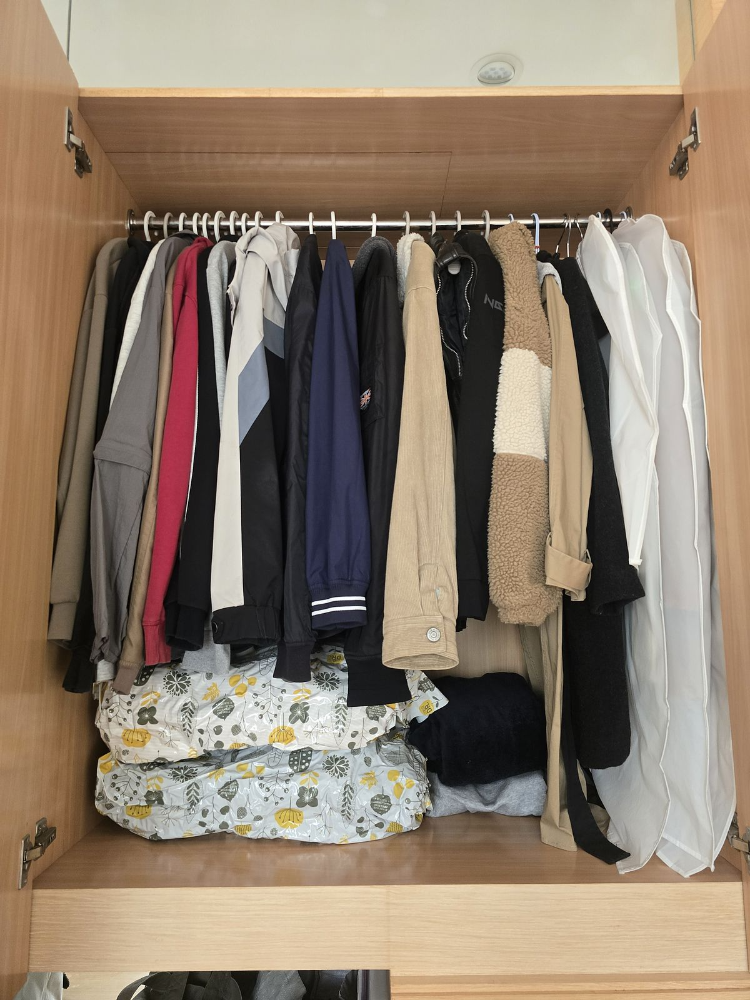
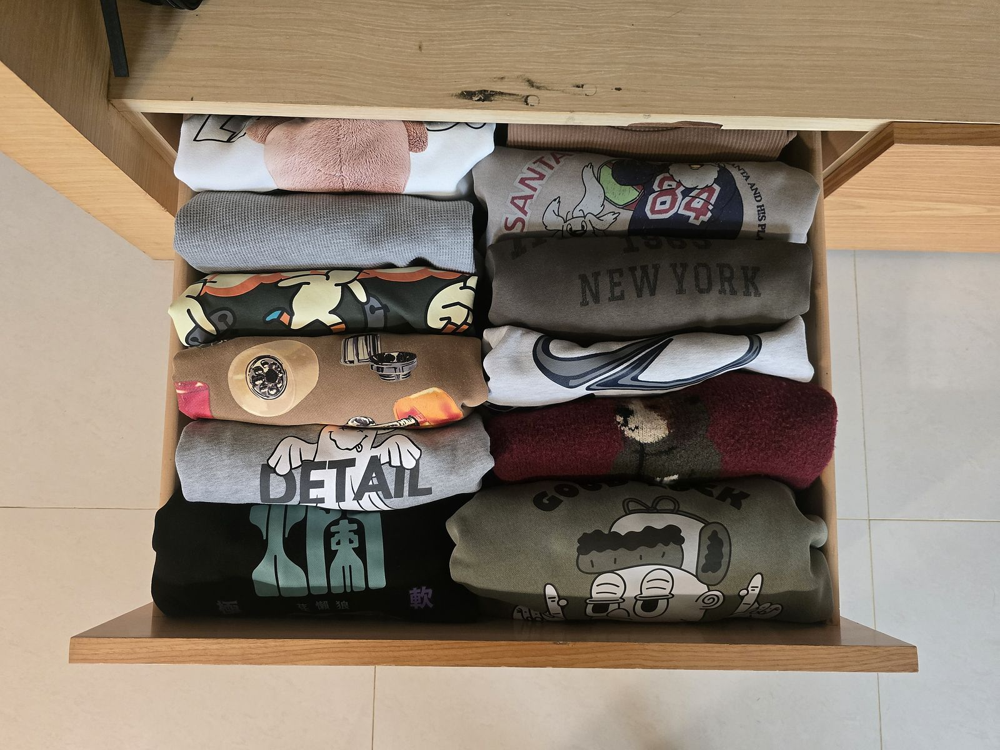
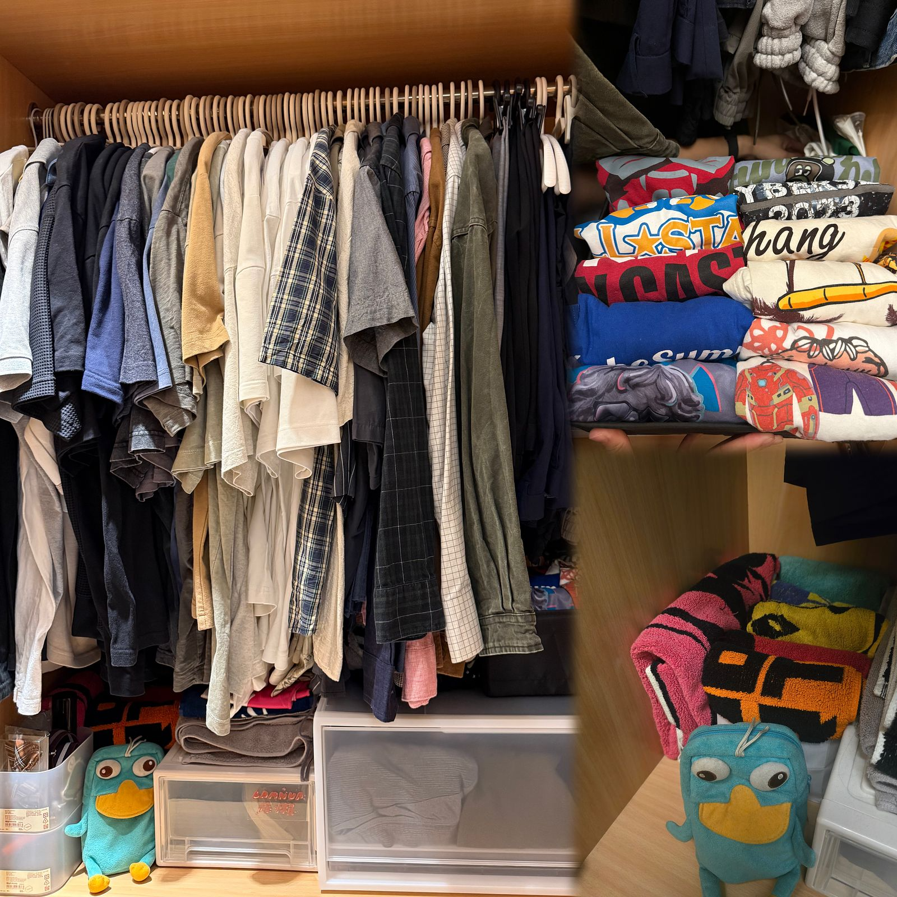
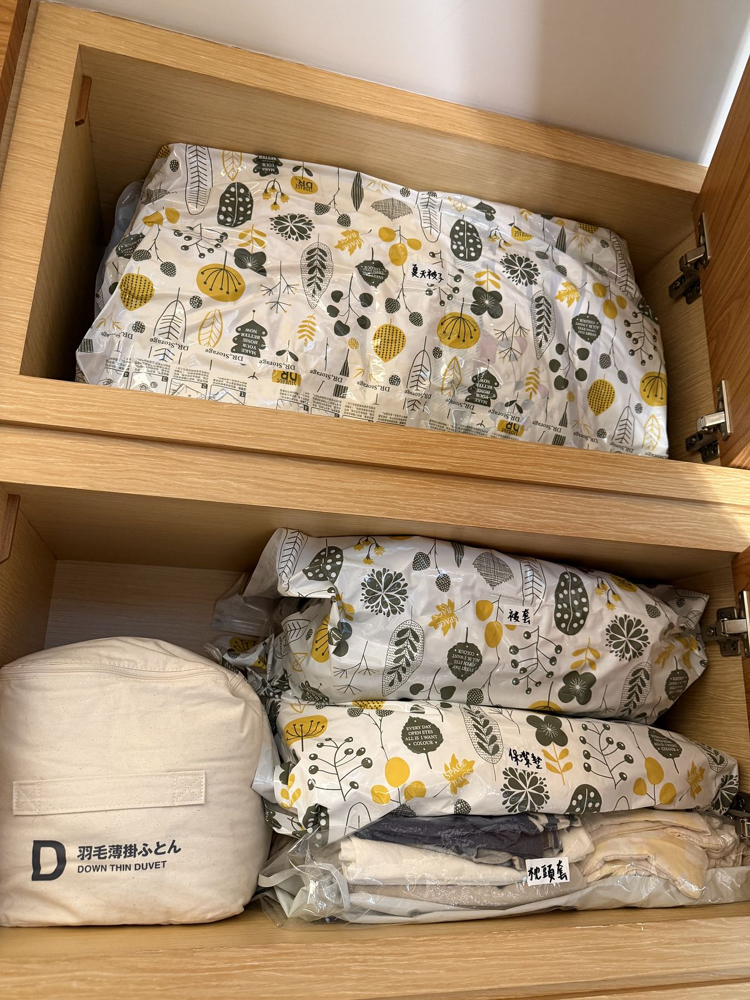

## 小空間整理案｜衣櫃

一般其實非常少會只有一位整理師出案（一方面也是安全考量）。
這次是非常難得的小空間整理案，整理的空間是主臥衣櫃。 

1位整理師／5小時

## 從衣櫃空間不夠，到讓每件衣服都有更適合的位置

整理前，最大的問題不是單純衣服太亂，是衣櫃裡不同類型的物品沒有依照使用方式安排位置。常用的東西不一定放在最好拿的地方，想找特定物品時，也常常需要翻找。

* 收納空間不足的緣故，發熱衣被隨意丟進衣櫃檯面的壓縮袋裡，需要穿的時候都要伸手進去翻找。
* 音樂祭毛巾沒有固定的位置，也只能隨意丟在衣櫃檯面上。
* 抽屜裡的衣物則以堆疊方式收納，拿取其中一件時不太方便，也不容易一次看清楚有哪些衣服。
* 寢具備品也收在衣櫃空間裡，讓原本有限的收納空間更加不足。

這次整理時，屋主希望改善的方向很明確：衣服要更好拿取、分類要更清楚，希望音樂祭毛巾、各分類都能有自己的位置。

## 先重新思考：什麼東西應該放在哪裡？
這次的整理重點，是依照物品的使用頻率重新配置。較常穿的衣服安排在衣櫃中比較容易拿取的位置。
冬天較少穿的外套、厚重的睡袍與棉被，則移到最旁邊、相對不方便拿取的區域。

厚帽 T 原本佔據了最黃金位置的掛衣區，除了因為衣服厚重相當佔空間以外，其實也非常少拿取（台灣冬天非常短暫啊）。

整理後，改用直立式的方式收納在最下層抽屜。打開抽屜時，可以清楚地看見每一件衣服，不需要一直翻找。
屋主也特別喜歡這個方式，覺得像是在展示每一件自己喜歡的衣服。

## 讓原本需要翻找的物品，有自己的專屬位置
發熱衣原本放在壓縮袋裡，雖然有收進衣櫃，但實際要使用時並不方便。
這次重新利用衣櫃的檯面空間，測量好尺寸之後請案主購買抽屜櫃，將發熱衣和運動相關物品安排進專屬抽屜。需要使用時，不必再從壓縮袋裡翻找。
原本放在抽屜內、容易凌亂堆疊的睡衣，也改放到較好拿取的衣櫃檯面，並安排固定的位置。
音樂祭毛巾同樣重新規劃收納區，讓它不再只是暫時放在檯面上，而是有自己的專屬位置。

（右上：黑色衣物收納籃內睡衣。右下：音樂祭毛巾專屬的家。）

## 把有限的衣櫃空間留給更常使用的物品
因為主臥衣櫃的空間有限，所有物品都放在同一個空間裡並不是最適合的做法。
因此，寢具先依照類別整理，再移到公共空間上層、較不常拿取的位置收納。這樣能把主臥衣櫃的空間，優先留給日常更常使用的衣物和用品。

整理完成後，睡衣、發熱衣和音樂祭毛巾都有了自己的位置；常穿的衣服也安排在更容易拿取的區域。
在有限的空間裡，重新安排每一類物品的位置。
**當收納位置開始符合實際的使用頻率，拿取、辨識與歸位也會變得更直接。**

屋主看到整理後的空間時表示，覺得東西都有了自己的「家」，看了心情非常好 💗

